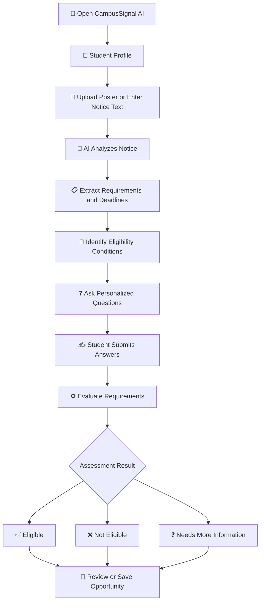
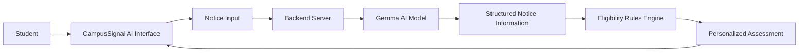

# 🎃 CampusSignal AI — Haunted Campus Edition 👻

### Discover Opportunities. Understand Requirements. Check Your Eligibility.

CampusSignal AI is a Halloween-themed, AI-powered campus opportunity assistant designed to help students understand college notices, discover opportunities, and assess their eligibility through a simple, personalized experience.

From scholarships and internships to workshops, hackathons, and student community events, CampusSignal AI aims to turn confusing notices into clear, actionable information.

> 👻 Don't let your next big opportunity disappear into the shadows!

---

## 🎯 Problem Statement

Students receive campus announcements through posters, PDFs, messaging groups, and college websites. Important details can be difficult to find, and students may miss opportunities because they:

- Cannot easily understand lengthy notices.
- Are unsure whether they meet eligibility criteria.
- Miss deadlines and required documents.
- Have difficulty finding relevant opportunities.
- Must repeatedly interpret different application requirements.

## 💡 Our Solution

CampusSignal AI simplifies opportunity discovery by combining AI-powered notice analysis with personalized eligibility assessment.

Students can submit a poster or notice text, review the extracted information, answer relevant questions, and receive an assessment explaining which requirements are satisfied or still need attention.

---

## ✨ Key Features

### 🧠 1. AI-Powered Notice Analysis
- Analyze notice text and supported poster uploads.
- Extract important information such as title, category, deadlines, eligibility, documents, fees, benefits, and application steps.
- Summarize lengthy announcements.
- Highlight unclear or missing information.

### 🎯 2. Personalized Eligibility Assessment
- Ask questions relevant to each opportunity.
- Evaluate conditions such as CGPA, income, course, year of study, technical skills, and community membership when applicable.
- Compare student answers with the stated requirements.
- Explain the result requirement by requirement.

**Possible outcomes:**
- ✅ Eligible
- ❌ Not Eligible
- ❓ Needs More Information

The assessment is informational and does not replace the official decision of a scholarship provider, employer, or event organizer.

### 🎓 3. Student Profile
- Maintain relevant student details.
- Support personalized assessments.
- Reduce repetitive questions where profile data can be reused.

### 📌 4. Opportunity Management
- Save useful opportunities.
- Review important details.
- Track deadlines where supported.

### 🌐 5. Student-Friendly Interface
- Simple and accessible design.
- Halloween-inspired visuals throughout the experience.
- Clear information and actionable next steps.

### 🎃 6. Haunted Campus Theme
- Spooky visual elements and Halloween styling.
- Themed interface designed for the hackathon.
- A consistent experience across application pages.

---

## 🔄 Application Flowchart



---

## 🏗️ System Architecture



### How the System Works

1. **Input:** The student submits a poster, notice, or text.
2. **AI processing:** The AI analyzes the notice and extracts relevant details.
3. **Requirement identification:** The system identifies the conditions students must satisfy.
4. **Personalized questions:** The application collects the information needed to assess those conditions.
5. **Rules evaluation:** The eligibility engine compares student answers with the requirements.
6. **Results:** The application explains satisfied, unsatisfied, and unknown requirements.
7. **Action:** The student can review the opportunity and save or track it where supported.

*The architecture represents the intended workflow. Actual AI calls, saved data, and individual features depend on the deployed implementation.*

---

## 🧪 Example: Scholarship Eligibility

Suppose a scholarship notice requires:

- Enrollment in an eligible course.
- A minimum CGPA of 8.5.
- Annual family income below ₹3,00,000.
- Submission of specified documents.

Example student information:

| Requirement | Student Information |
|---|---|
| Eligible course | Yes |
| CGPA | 8.8 |
| Annual family income | ₹2,50,000 |
| Documents submitted | Not confirmed |

**Expected assessment:** Needs More Information, because document submission has not been confirmed.

This example illustrates how the system can explain individual requirements instead of providing an unexplained yes-or-no answer.

---

## 🛠️ Technology Stack

The project uses the following technologies, subject to the final implementation:

| Technology | Purpose |
|---|---|
| React | User interface |
| TypeScript | Application logic and type safety |
| Vite | Frontend development and build tooling |
| Node.js | Backend runtime |
| Google Gen AI SDK | AI integration |
| Google Gemma | Notice understanding and information extraction |
| Tailwind CSS | Interface styling |
| Vercel or compatible hosting | Deployment |

---

## 🚀 Getting Started

### Prerequisites

- Node.js and npm installed.
- The project repository downloaded or cloned.
- Required environment variables configured securely for AI features.

### Clone the Repository

```bash
git clone https://github.com/GuruprasadSunagar/campussignal-ai.git
cd campussignal-ai
```

### Install Dependencies

```bash
npm install
```

If npm reports a peer-dependency conflict during installation, investigate the dependency versions in `package.json` and the lockfile before using a temporary installation workaround.

### Run the Application

Use the development command defined in the project's `package.json`. For example:

```bash
npm run dev
```

Follow the terminal output to open the local application.

The exact commands may vary depending on the configured frontend and backend scripts.

---

## 🔐 Security and Privacy

- Secret credentials must not be committed to the repository.
- Environment files containing secrets should be excluded from Git.
- AI credentials should be configured through secure environment-variable settings.
- Student information should be collected only when necessary and protected appropriately.
- Eligibility assessments should explain uncertainty and missing information.

---

## 🔮 Future Scope

- 📅 Automated deadline reminders.
- 🎓 More scholarship, internship, placement, and hackathon listings.
- 🌍 Additional Indian-language support.
- 📄 Improved PDF and image extraction.
- 🔔 Notifications for upcoming opportunities.
- 🏫 College notice-board integrations.
- 📊 Personalized opportunity recommendations.
- 🧪 Automated testing and improved AI extraction accuracy.

---

## 🏆 Hackathon Impact

CampusSignal AI aims to reduce the gap between receiving a campus announcement and understanding what action to take.

By combining notice interpretation with requirement-based eligibility assessment, it helps students focus on relevant opportunities and understand what they need to do next.

### Our Vision

**Every student deserves a clearer path to every opportunity.**

---

## 📌 Project Details

- **Project Name:** CampusSignal AI
- **Edition:** Haunted Campus Edition
- **Category:** AI for Education / Student Productivity
- **Repository:** [GitHub — CampusSignal AI](https://github.com/GuruprasadSunagar/campussignal-ai)
- **Live Demo:** Add the working deployment URL here.

---

### 🎃 Built for a Hackathon

Made with AI, creativity, and a little Halloween magic. 👻

*Students should verify official eligibility criteria, application deadlines, and final decisions with the relevant opportunity provider.*
